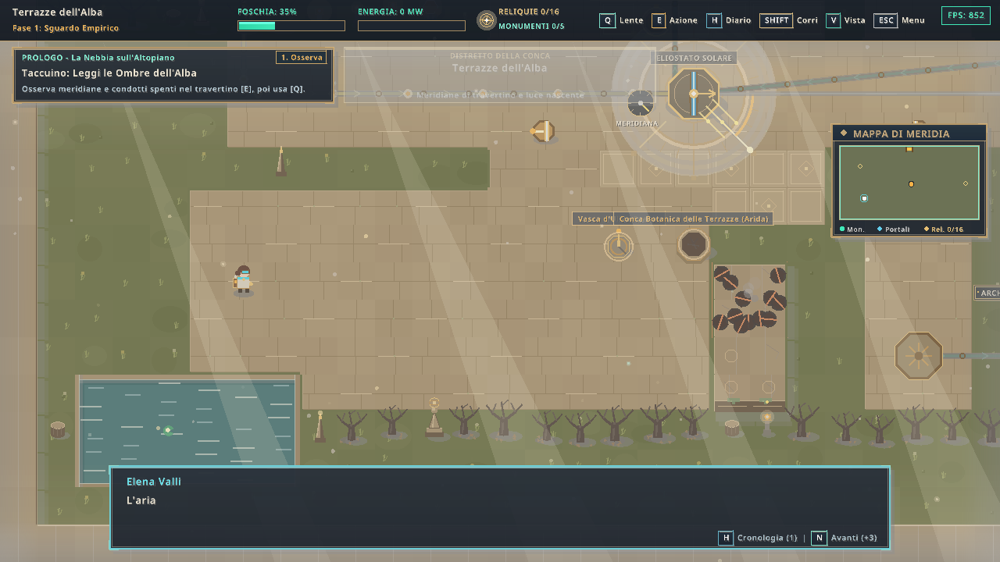
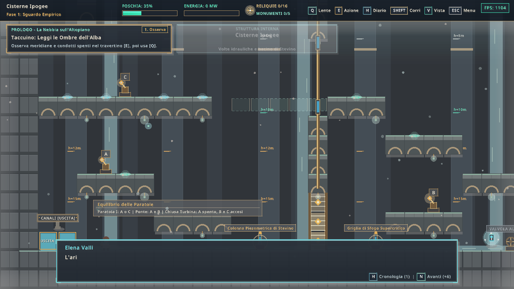
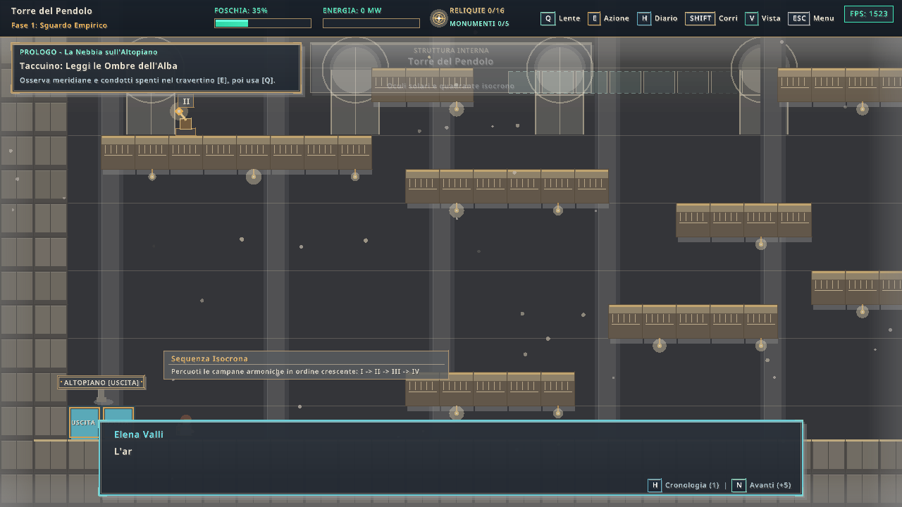
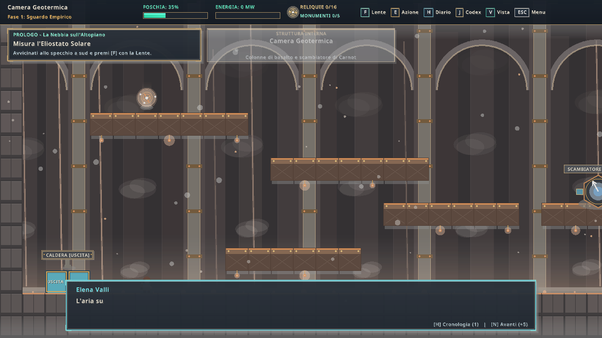

# EQUILIBRIO — La Conca di Meridia

Videogioco 2D in **C++20 e Raylib 5.5** basato sulla fisica empirica, sulla matematica applicata, sull'ecologia e sull'archeologia di una civilta' perduta.

Ambientato sull'altopiano monumentale de **La Conca di Meridia**, segue la naturalista e cartografa **Elena Valli** mentre esplora **6 distretti separati in superficie** e **3 strutture interne**, raccoglie **16 reliquie** distribuite in **4 Ere storiche** e riattiva **5 monumenti fisici + l'Astrolabio Centrale** (Ottica di Lambert, Idrostatica di Stevino, Pendolo Isocrono di Galileo, Risonanza Armonica Lorentziana, Termodinamica di Carnot e Interferenza di Fase), scegliendo se guarire la Conca con il calcolo o cedere alle fornaci a pece di Matteo Verrini.

Include:
- **6 Zone Separate a Mappa Dedicata (`26x36` tile)** caricate on-demand in memoria (una sola mappa residente in RAM alla volta per ottimizzazione footprint).
- **6 Meccaniche Top-Down Uniche**: specchi e fasci solari con piastre fotosensibili, correnti d'acqua fisiche con chiuse a leva, raffiche di vento periodiche con monoliti frangivento, piastre acustiche di risonanza armonica con sblocco del Ponte di Giada, geyser termici ciclici con valvole di sfogo, e accordatura dei sigilli elementali dell'Astrolabio.
- **Intramezzi Panoramici tra Zone**: transizioni visive e narrative dipinte proceduralmente ad ogni passaggio di soglia, con parallasse, versi storici dedicati e skip rapido (`SPAZIO`).
- **Menu di Pausa & Impostazioni Riprogettato**: 4 schede intuitive (**Gioco**, **Grafica**, **Ambiente**, **Audio**), slider trascinabili col mouse, mute rapido `[M]`, reset predefiniti per scheda.
- **Controlli Effetti Ambientali & Audio Granulari**: intensita' regolabile in tempo reale per atmosfera, particelle, foschia/nebbia, raggi solari, vignettatura e meteo di zona; volumi separati per Master, Musica, Effetti e Ambiente naturale con anteprima live.
- **Cronologia dei Dialoghi (`[H]`)** e **Codex delle 16 Reliquie (`[J]`)** con riposizionamento lore-accurate in tutte le zone.
- **Salvataggio automatico/manuale con "Riprendi da dove hai lasciato"** e sfondo ridisegnato dinamicamente per distretto e foschia.
- **Selezione del Monitor** e **Selezione GPU OpenGL** (NVIDIA / Intel / AMD) su Linux e multi-schermo.

---

## Galleria Visiva — La Conca di Meridia

| Titolo — Riprendi Partita (`22_titolo_riprendi_zona.png`) | Impostazioni Schermo, GPU & Audio (`21_impostazioni_monitor_gpu.png`) | Terrazze dell'Alba (`09_terrazze_alba.png`) |
|---|---|---|
|  |  |  |

| Giardini Sospesi (`10_giardini_sospesi.png`) | Caldera delle Fumarole (`11_caldera_fumarole.png`) | Santuario dell'Armonia (`12_santuario_astrolabio.png`) |
|---|---|---|
|  |  |  |

| Cisterne Ipogee (`13_cisterne_ipogee.png`) | Torre del Pendolo (`14_torre_pendolo.png`) | Camera Geotermica (`15_camera_geotermica.png`) |
|---|---|---|
|  |  |  |

| Cronologia Dialoghi `[H]` (`16_cronologia_dialoghi.png`) | Codex Reliquie `[J]` (`17_codex_reliquie.png`) | Modal Risonatore (`18_modal_risonatore.png`) |
|---|---|---|
|  |  |  |

---

## Compilazione, Esecuzione e Test

```bash
# Configura e compila
cmake -S . -B build
cmake --build build -j8

# Avvia il gioco (Campagna Completa attiva di default)
./build/eco_proto

# Esegui unit test e test headless E2E
cd build && ctest --output-on-failure
```

### Opzioni da Riga di Comando (`eco_proto`)
- `--gpu auto|nvidia|intel|amd`: seleziona la GPU OpenGL prima dell'avvio (su Linux commuta tra NVIDIA PRIME/EGL e Mesa Intel/AMD; impostabile anche in-game nelle Impostazioni con pulsante `Applica GPU & Riavvia`).
- `--monitor -1|0|1|...`: sceglie il monitor per lo schermo intero (`-1` = monitor corrente, `0` = Monitor 1, `1` = Monitor 2, ecc.; regolabile anche dal menu Impostazioni e salvato in `saves/settings.cfg`).
- `--mute`: avvia il gioco con l'audio silenziato.
- `--skip-title`: salta il titolo e avvia direttamente nell'Overworld.
- `--scene title|intro|overworld|structure`: avvia nella scena indicata.
- `--zone dawn|canals|wind|gardens|caldera|sanctuary`: posiziona Elena nel distretto scelto.
- `--structure cisterns|pendulum|geothermal` (o `0|1|2`): entra direttamente nella struttura interna indicata.
- `--pollution N`: imposta la foschia iniziale (`0..100`).
- `--open-history` / `--open-codex`: apre subito il Diario sul tab Cronologia Dialoghi (`[H]`) o Codex Reliquie (`[J]`).
- `--open-pause` / `--open-settings`: apre direttamente il menu di pausa o le impostazioni.
- `--collect-all` / `--clean-all` / `--epilogue`: preset utili per ispezionare archivio completo, monumenti calibrati o epilogo.
- `--smoke-frames N` + `--screenshot FILE`: chiude dopo `N` frame salvando uno screenshot (supporta percorsi assoluti e relativi).
- `--headless-e2e`: esegue la suite end-to-end deterministica senza finestra grafica (include la validazione completa delle 6 zone separate, metriche di memoria residenti e swap intramezzi).

---

## Controlli di Gioco

| Tasto / Input | Azione |
|---|---|
| `WASD` / `Frecce` / Stick Sinistro | Movimento (Top-Down nelle 6 zone, Side-Scrolling nelle 3 Strutture) |
| `SPAZIO` / `W` / `SU` | Salto nelle Strutture interne / **Salta Intramezzo** durante la transizione tra zone |
| `F` / `Q` / `.` | **Lente Empirica** (misura il parametro fisico del monumento o dell'elemento piu' vicino) |
| `E` / `INVIO` | **Interagisci** con monumenti, personaggi (Clara, Lorenzo, Miriam, Matteo), leve, specchi, valvole, reliquie o conferma menu |
| `A`/`D` / `Frecce` / Mouse (nel modal) | Regola il parametro fisico del monumento |
| `C` / `INVIO` (nel modal) | **Conferma Calibrazione Pulita** |
| `B` (nel modal) | **Fornace a Pece di Emergenza** (energia immediata ma +Foschia; disabilitata sull'Astrolabio) |
| `X` / `BACKSPACE` | Chiude modal / Salta il diario introduttivo |
| `H` | **Diario di Campo — Cronologia Dialoghi** (scorribile con `W/S`, Frecce, rotellina; filtra capitoli con `A/D`) |
| `J` | **Diario di Campo — Codex Reliquie** (16 reliquie divise per 4 Ere storiche dei Meridiani) |
| `V` | Cambia **Fase Percettiva** (Fase 1 Sguardo Empirico -> Fase 2 Rilievo Metrico -> Fase 3 Trama Geodetica) |
| `N` | **Avanza Dialogo** / Completa battuta |
| `TAB` | Cambio rapido Overworld <-> Struttura attiva (o cambia tab dentro il Diario e nelle Impostazioni) |
| `ESC` | Chiude Calibrazione -> Chiude Diario -> Apre/Chiude **Menu di Pausa & Impostazioni** |
| `O` (dal Titolo) | Apre direttamente le **Impostazioni (Gioco, Grafica, Ambiente, Audio)** |
| `M` | Attiva/Disattiva rapidamente **Audio (Muto)** preservando i livelli di volume |
| `F11` / `Alt+INVIO` | Attiva/Disattiva **Schermo Intero** sul **Monitor selezionato** |

---

## Funzionalita' Principali e Novita'

### 1. Ridisegno Mappa & Architettura a Zone Separate
- **6 Mappe Indipendenti (`26x36` tile)**:
  - *Terrazze dell'Alba*: lastricati solari, meridiane in ottone e corridoi d'allineamento ottico.
  - *Quartiere dei Canali*: banchine d'acqua, canali guadabili e il monumentale Ponte degli Archi.
  - *Altopiano dei Venti*: costoni rocciosi battuti da folate violente e monoliti frangivento in basalto.
  - *Giardini Sospesi*: terrazzamenti botanici con vasche d'acqua e piattaforme acustiche in giada.
  - *Caldera delle Fumarole*: distese vulcaniche solcate da getti termici e condutture in rame.
  - *Santuario dell'Armonia*: piazza cerimoniale ellittica che ospita l'Astrolabio Centrale e i 5 sigilli elementali.
- **Ottimizzazione Memoria Reale**:
  - Viene mantenuta residente in RAM **solo la mappa della zona attualmente attiva** (`936 B` di griglia per zona, oltre `6.3 KB` risparmiati rispetto al caricamento simultaneo).
  - Al varco tra zone, la vecchia tilemap e le cache procedurali (affreschi e prop) vengono liberate con deallocazione esplicita (`ReleaseOverworldProceduralCache()`), rigenerando on-demand solo gli asset della nuova destinazione.
  - Statistiche di memoria costantemente tracciate ed esposte via `WorldContext::GetMemoryMetrics()`.

### 2. Meccaniche Top-Down Uniche per Zona
Ogni livello 2D possiede ora un gameplay e una fisica propria:
1. **Terrazze dell'Alba — Emettitore & Specchi Solari**:
   - Fascio luminoso orientabile ruotando 3 specchi a prisma con `[E]`.
   - Caricamento delle piastre fotosensibili all'incidenza del raggio per disattivare la barriera energetica (*SolarGate*) e sbloccare passaggi e reliquie.
2. **Quartiere dei Canali — Correnti Idrauliche & Chiuse**:
   - I canali bassi (`ShallowChannel`) esercitano una reale forza idrodinamica sul giocatore.
   - Leve di manovra (`[E]`) deviano il flusso e abbassano le chiuse per rendere sicuro il transito.
3. **Altopiano dei Venti — Raffiche Dinamiche & Monoliti Frangivento**:
   - Cicli periodici di vento con telegraphing visivo e sonoro che spingono fisicamente Elena.
   - 5 grandi monoliti in basalto creano aree d'ombra aerodinamica (*shelter zone*) dietro cui ripararsi durante la raffica.
4. **Giardini Sospesi — Nodi di Risonanza Acustica**:
   - 4 piastre armoniche intonate (accordo di Do Maggiore: C4, E4, G4, C5) che emettono onde sonore e particelle intonate.
   - Calpestare la sequenza corretta materializza gradualmente il *Ponte di Giada* sospeso sulle acque.
5. **Caldera delle Fumarole — Geyser Termici & Valvole di Sfogo**:
   - 6 crateri geotermici ciclici a 4 fasi (*Dormant*, *Telegraphing*, *Erupting*, *Calmed*) che respingono in sicurezza chi si avvicina durante l'eruzione.
   - 2 valvole di sfogo azionabili per canalizzare il vapore e raffreddare stabilmente i getti.
6. **Santuario dell'Armonia — Sigilli Elementali dell'Astrolabio**:
   - 5 sigilli radiali corrispondenti ai 5 distretti periferici, che si accordano e illuminano all'attivazione delle rispettive macchine.

### 3. Intramezzi di Soglia Narrativi e Visivi
- Attraversando uno dei 5 varchi monumentali tra zone si attiva una sequenza di intramezzo procedurale con dissolvenza, parallasse dello sfondo e polvere atmosferica.
- Ogni passaggio propone un testo poetico e storico scritto per la specifica direzione del viaggio (`ZoneInterludeCopy()`).
- Possibilita' di saltare istantaneamente la transizione premendo `SPAZIO`, `INVIO`, `E` o `ESC` (istantanea in test automatizzati `--headless-e2e`).

### 4. Menu di Pausa, Regolazioni Ambientali e Audio
- **Layout a 4 Schede** navigabile sia da tastiera (`[Q/E]`, `[TAB]`, `[1-4]`, frecce) sia interamente col mouse:
  1. *Gioco*: velocita' dialoghi, tutorial compatto, mostra FPS.
  2. *Grafica*: modalita' finestra/fullscreen, selettore monitor dedicato, risoluzione sicura, FPS target, selettore GPU fisica con riavvio automatico.
  3. *Ambiente*: toggle generale atmosfera, densita' particelle (0..100%), intensita' foschia/nebbia, raggi solari volumetrici, intensita' vignetta cinematografica, intensita' effetti meteo di zona (raffiche, vapore, pollini).
  4. *Audio*: toggle mute rapido, volume principale, volume musica procedurale, volume effetti/interazioni, volume atmosfera/natura, toggle ambiente, toggle suoni interfaccia, con campionamento sonoro in tempo reale durante la regolazione.
- Salvataggio persistente e automatico in `saves/settings.cfg`.

### 5. Collezionabili & Codex Storico
- 16 reliquie archeologiche divise in 4 Ere storiche dei Meridiani, riposizionate nei nuovi scenari in modo organico e sicuro da raggiungere.
- Consultabili in qualsiasi momento con il tasto `[J]` (Codex Reliquie) con analisi scientifiche, estratti di diario e contributi narrativi degli NPC.

---

## Documentazione e Diario delle Modifiche (`docs/`)

- [`docs/VISION.md`](docs/VISION.md) — Visione creativa, pilastri di design e progressione percettiva.
- [`docs/STORIA.md`](docs/STORIA.md) — Bibbia narrativa de *La Conca di Meridia*: 4 Ere, cast, geografia, 16 reliquie e 3 finali.
- [`docs/DIALOGHI.md`](docs/DIALOGHI.md) — Copione integrale dei 7 capitoli, 32 eventi, 16 schede Codex ed epiloghi.
- [`docs/ART_DIRECTION.md`](docs/ART_DIRECTION.md) — Direzione artistica multi-bioma, architetture 2.5D, monumenti, reliquie e stile UI.
- [`docs/DISCUSSIONE.md`](docs/DISCUSSIONE.md) — Verbale della discussione collegiale a 6 agenti (2 narratori, 2 artisti, 2 ingegneri).
- [`docs/COLLABORATORI.md`](docs/COLLABORATORI.md) — Squadra a 6 agenti, proprieta' dei file e regole di verifica.
- [`docs/ROADMAP.md`](docs/ROADMAP.md) — Milestone completate e prossimi orizzonti.
- [`docs/DEVLOG.md`](docs/DEVLOG.md) — Registro cronologico degli sviluppi.
- **Log puntuali delle modifiche in `docs/modifiche/`**:
  - [`00_piano_e_avvio.md`](docs/modifiche/00_piano_e_avvio.md)
  - [`01_mondo_e_civilta.md`](docs/modifiche/01_mondo_e_civilta.md)
  - [`02_dialoghi_e_reliquie.md`](docs/modifiche/02_dialoghi_e_reliquie.md)
  - [`03_motore_core_e_zone.md`](docs/modifiche/03_motore_core_e_zone.md)
  - [`04_ui_cronologia_e_test.md`](docs/modifiche/04_ui_cronologia_e_test.md)
  - [`04b_fix_separatore_cronologia.md`](docs/modifiche/04b_fix_separatore_cronologia.md)
  - [`05_ambientazioni_e_dettagli.md`](docs/modifiche/05_ambientazioni_e_dettagli.md)
  - [`06_personaggi_collezionabili_vfx.md`](docs/modifiche/06_personaggi_collezionabili_vfx.md)
  - [`07_integrazione_finale_e_verifica.md`](docs/modifiche/07_integrazione_finale_e_verifica.md)
  - [`08_audio_procedurale_e_interazioni.md`](docs/modifiche/08_audio_procedurale_e_interazioni.md)
  - [`09_monitor_gpu_e_salvataggio.md`](docs/modifiche/09_monitor_gpu_e_salvataggio.md)
  - [`10_divisione_zone_memoria_e_guida.md`](docs/modifiche/10_divisione_zone_memoria_e_guida.md)
  - [`11_stacchi_visivi_portali_e_bussola.md`](docs/modifiche/11_stacchi_visivi_portali_e_bussola.md)
