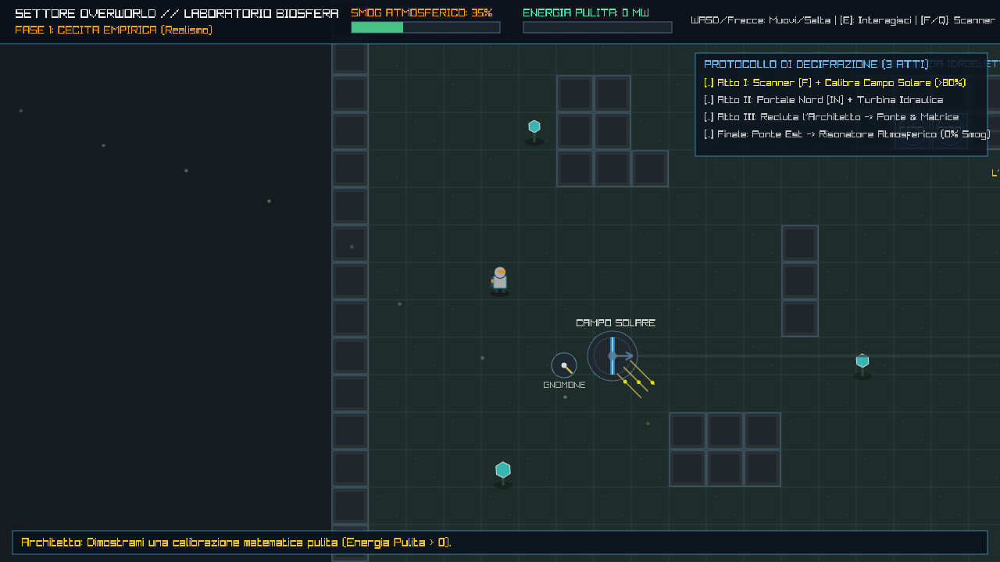
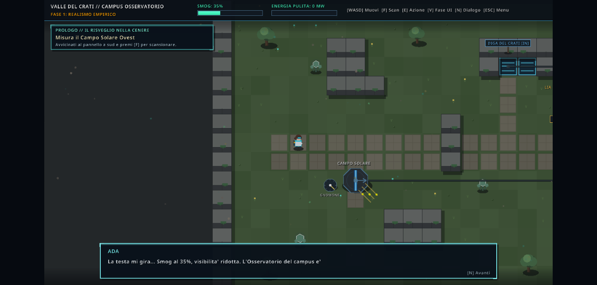
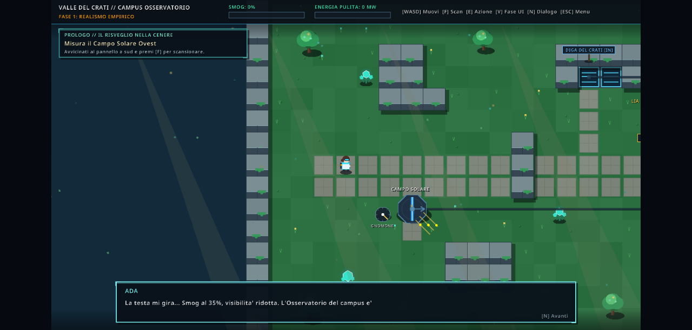
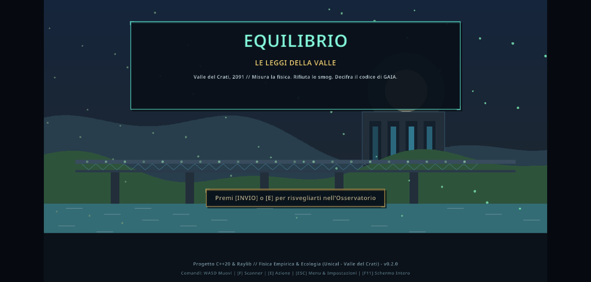
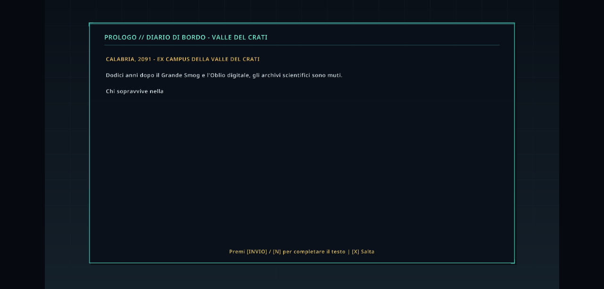
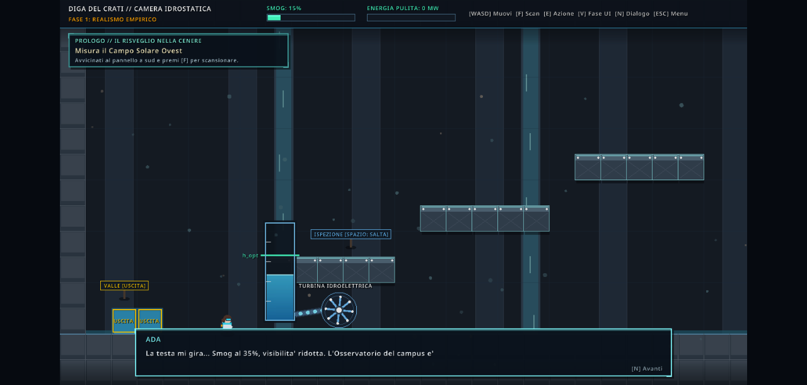
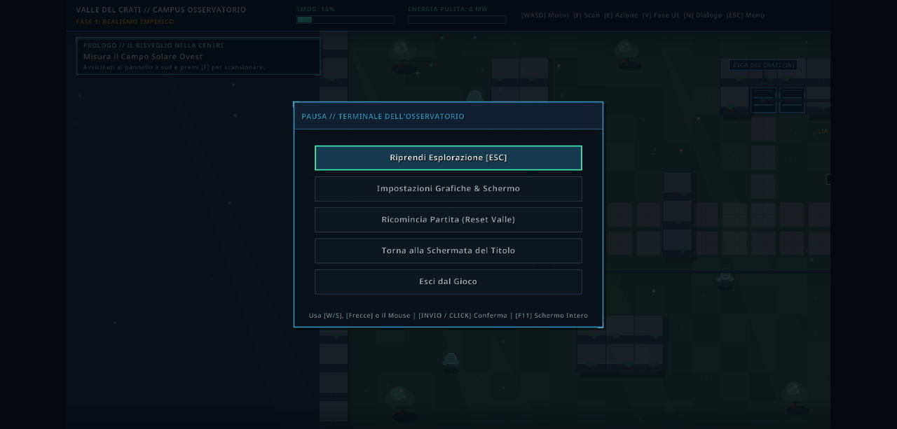
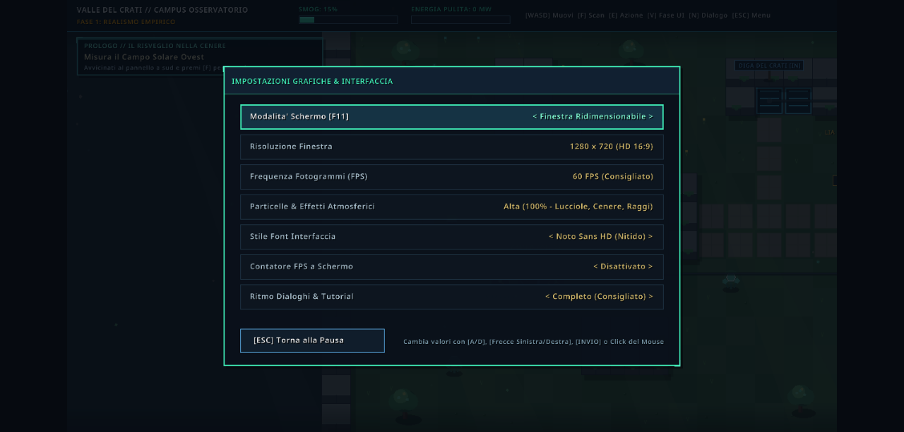

# EQUILIBRIO — Le Leggi della Valle

Videogioco 2D in **C++20 e Raylib 5.5** basato sulla fisica empirica, sulla matematica applicata e sull'ecologia.
Ambientato nel **2091** nell'ex campus universitario della **Valle del Crati** (Unical), segue la ricercatrice **Ada Ferri** mentre misura e calibra gli impianti energetici della valle (legge di Lambert del coseno solare, legge idrostatica di Stevino, risonanza fotonica) rifiutando la scorciatoia inquinante del Consorzio Brace, fino a svelare la natura simulata del modello **GAIA**.

---

## Confronto Visivo (Prima -> Dopo)

| Prima (`00_prima.png`) | Dopo — Valle Ferita (`03_valle_inquinata.png`) | Dopo — Valle Guarita (`04_valle_guarita.png`) |
|---|---|---|
|  |  |  |

| Schermata del Titolo (`01_titolo.png`) | Diario Introduttivo (`02_intro.png`) | Diga del Crati (`05_diga.png`) |
|---|---|---|
|  |  |  |

| Menu di Pausa `[ESC]` (`06_menu_pausa.png`) | Menu Impostazioni Grafiche (`07_menu_impostazioni.png`) |
|---|---|
|  |  |

---

## Compilazione, Esecuzione e Test

```bash
# Configura e compila
cmake -S . -B build
cmake --build build -j8

# Avvia il gioco (parte dalla schermata del titolo)
./build/eco_proto

# Esegui la suite di unit test e test headless E2E
cd build && ctest --output-on-failure
```

### Opzioni da Riga di Comando (`eco_proto`)
- `--skip-title`: salta la schermata del titolo e avvia direttamente nell'Overworld.
- `--scene title|intro|overworld|structure`: avvia direttamente nella scena indicata.
- `--pollution N`: imposta il livello iniziale di smog (`0..100`, es. `--pollution 0` per vedere la Valle Guarita).
- `--smoke-frames N`: chiude automaticamente dopo `N` frame.
- `--screenshot FILE`: salva uno screenshot all'ultimo frame di `--smoke-frames N` (nella directory di lavoro corrente).
- `--headless-e2e`: esegue il test end-to-end deterministico senza finestra grafica.

---

## Controlli di Gioco

| Tasto / Input | Azione |
|---|---|
| `WASD` / `Frecce` / Stick Sinistro | Movimento (Top-Down nella Valle, Side-Scrolling nella Diga) |
| `SPAZIO` / `W` / `SU` | Salto nella Diga del Crati (con Coyote Time e Jump Buffer) |
| `F` / `Q` / `.` | **Scanner Empirico** (misura l'angolo solare o la quota piezometrica) |
| `E` / `INVIO` | **Interagisci** con impianti, Lia Moretti o avvia dal titolo |
| `A`/`D` o `Frecce` (nel modal) | Regola il parametro fisico dell'impianto |
| `C` / `INVIO` (nel modal) | **Conferma Calibrazione Pulita** (richiede efficienza >= 80%) |
| `B` (nel modal) | **Bypass a Combustione Fossile** (energia immediata ma +Smog!) |
| `X` / `BACKSPACE` | Annulla modal / Salta l'introduzione |
| `V` | Cambia **Fase UI** (Fase 1 Realismo -> Fase 2 Telemetria -> Fase 3 Matrice) |
| `N` | **Avanza Dialogo** / Completa riga a macchina da scrivere |
| `TAB` | Cambio rapido scena Valle <-> Diga |
| `ESC` | **Menu di Pausa & Impostazioni Grafiche** (non chiude il gioco!) |
| `F11` / `Alt+INVIO` | Attiva/Disattiva **Schermo Intero (Borderless)** in qualsiasi momento |

---

## Versioning Git e Push su GitHub

Il repository Git locale contiene i tag delle versioni:
- **`v0.1.0`** — Prima versione completa (Storia + Grafica Procedurale 2.5D).
- **`v0.2.0`** — Font TTF ad alta leggibilita' (`Noto Sans SemiBold`), Schermo Intero (`F11`) con letterbox 16:9, Menu di Pausa (`ESC`) e Menu Impostazioni Grafiche.

Per caricare tutto su un nuovo repository **GitHub**:
```bash
git remote add origin https://github.com/<tuo-username>/<nome-repo>.git
git push -u origin main --tags
```

---

## Documentazione per i Collaboratori (`docs/`)

Tutta la documentazione progettuale, narrativa e tecnica prodotta e discussa dal team si trova nella cartella [`docs/`](docs/):

- **[`docs/VISION.md`](docs/VISION.md)** — Direzione creativa, logline, i 4 pilastri di design e fusione dei concept originari.
- **[`docs/STORIA.md`](docs/STORIA.md)** — Bibbia narrativa completa: cronologia 2048-2091, personaggi (Ada, Lia, Bruno, Nonna Rosa, GAIA), fisica diegetica, i 5 capitoli e i due finali (Pulito vs Grigio).
- **[`docs/DIALOGHI.md`](docs/DIALOGHI.md)** — Copione integrale dei dialoghi in-game, testo introduttivo, epiloghi e tabella degli obiettivi dinamici.
- **[`docs/ART_DIRECTION.md`](docs/ART_DIRECTION.md)** — Guida alla grafica procedurale 2.5D, palette dinamica Valle Ferita <-> Valle Guarita, anatomia dei personaggi e delle 3 macchine, layout HUD.
- **[`docs/COLLABORATORI.md`](docs/COLLABORATORI.md)** — Organizzazione del team, tabella di proprieta' dei file, regole di build e verifica.
- **[`docs/DISCUSSIONE.md`](docs/DISCUSSIONE.md)** — Verbale della discussione critica tra Narratore, Ingegnere, Artista e Coordinatore con le decisioni architetturali e di design.
- **[`docs/ROADMAP.md`](docs/ROADMAP.md)** — Checklist delle fasi completate e roadmap per gli sviluppi futuri.
- **[`docs/DEVLOG.md`](docs/DEVLOG.md)** — Diario tecnico dettagliato degli interventi di ciascun membro del team.
