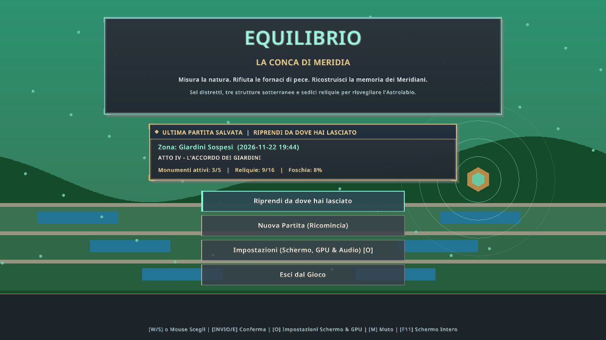
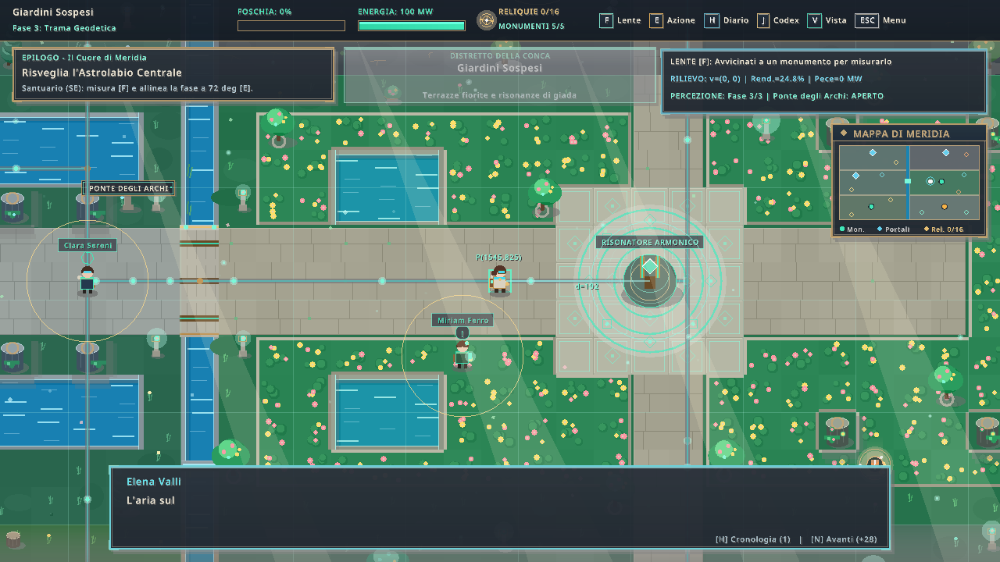
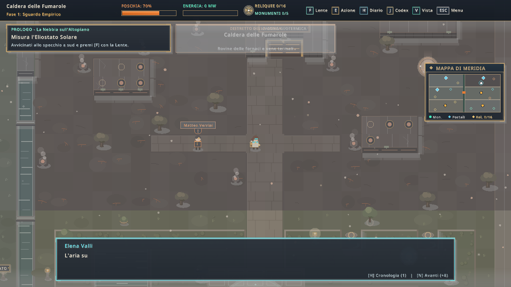
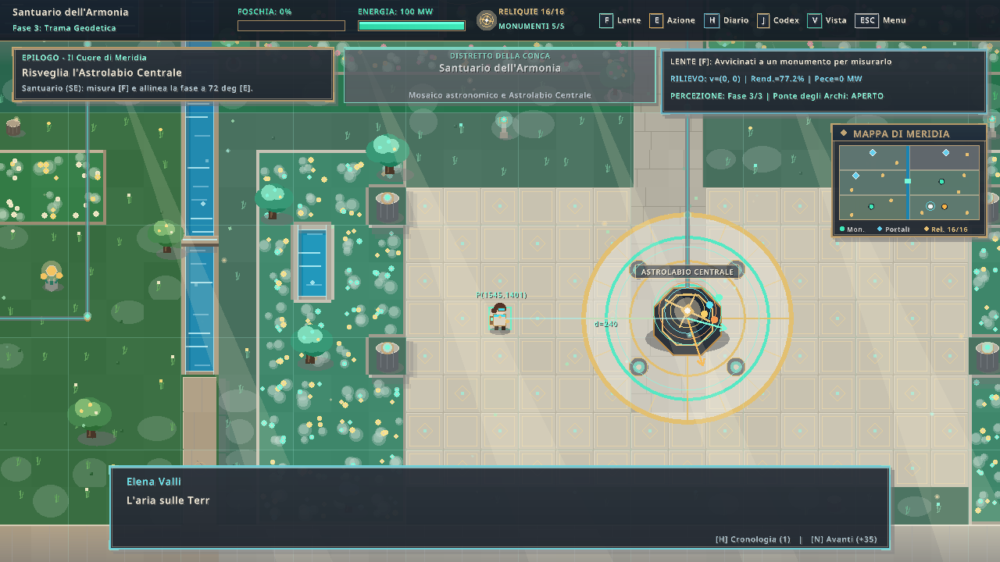
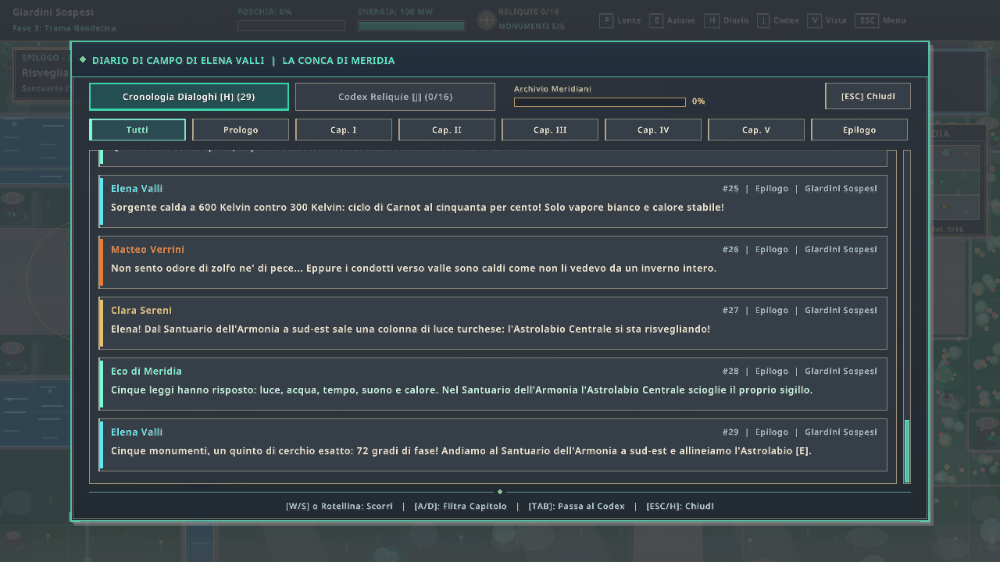
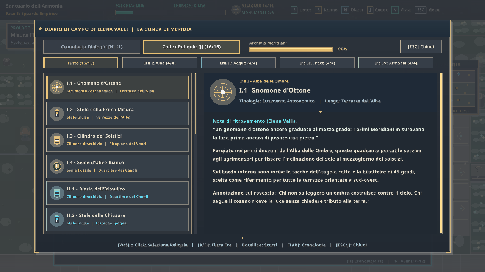

# EQUILIBRIO — La Conca di Meridia

Videogioco 2D in **C++20 e Raylib 5.5** basato sulla fisica empirica, sulla matematica applicata, sull'ecologia e sull'archeologia di una civilta' perduta.

Ambientato sull'altopiano monumentale de **La Conca di Meridia**, segue la naturalista e cartografa **Elena Valli** mentre esplora **6 distretti in superficie** e **3 strutture interne**, raccoglie **16 reliquie** distribuite in **4 Ere storiche** e riattiva **5 monumenti fisici + l'Astrolabio Centrale** (Ottica di Lambert, Idrostatica di Stevino, Pendolo Isocrono di Galileo, Risonanza Armonica Lorentziana, Termodinamica di Carnot e Interferenza di Fase), scegliendo se guarire la Conca con il calcolo o cedere alle fornaci a pece di Matteo Verrini.

Include **Cronologia dei Dialoghi (`[H]`)**, **Codex delle 16 Reliquie (`[J]`)**, **audio procedurale** (suoni ambientali e di interazione senza voci sui dialoghi), **salvataggio automatico/manuale con menu "Riprendi da dove hai lasciato" e sfondo ridisegnato della zona salvata**, **selezione del monitor per lo schermo intero** e **selezione della GPU** (NVIDIA / Intel / AMD).

---

## Galleria Visiva — La Conca di Meridia

| Titolo — Riprendi Partita (`22_titolo_riprendi_zona.png`) | Impostazioni Schermo, GPU & Audio (`21_impostazioni_monitor_gpu.png`) | Terrazze dell'Alba (`09_terrazze_alba.png`) |
|---|---|---|
|  |  |  |

| Giardini Sospesi (`10_giardini_sospesi.png`) | Caldera delle Fumarole (`11_caldera_fumarole.png`) | Santuario dell'Armonia (`12_santuario_astrolabio.png`) |
|---|---|---|
|  |  |  |

| Cisterne Ipogee (`13_cisterne_ipogee.png`) | Torre del Pendolo (`14_torre_pendolo.png`) | Camera Geotermica (`15_camera_geotermica.png`) |
|---|---|---|
|  |  |  |

| Cronologia Dialoghi `[H]` (`16_cronologia_dialoghi.png`) | Codex Reliquie `[J]` (`17_codex_reliquie.png`) | Modal Risonatore (`18_modal_risonatore.png`) |
|---|---|---|
|  |  |  |

---

## Compilazione, Esecuzione e Test

```bash
# Configura e compila
cmake -S . -B build
cmake --build build -j8

# Avvia il gioco (Campagna Completa attiva di default)
./build/eco_proto

# Esegui unit test e test headless E2E
cd build && ctest --output-on-failure
```

### Opzioni da Riga di Comando (`eco_proto`)
- `--gpu auto|nvidia|intel|amd`: seleziona la GPU OpenGL prima dell'avvio (su Linux commuta tra NVIDIA PRIME/EGL e Mesa Intel/AMD; impostabile anche in-game nelle Impostazioni con pulsante `Applica GPU & Riavvia`).
- `--monitor -1|0|1|...`: sceglie il monitor per lo schermo intero (`-1` = monitor corrente, `0` = Monitor 1, `1` = Monitor 2, ecc.; regolabile anche dal menu Impostazioni e salvato in `saves/settings.cfg`).
- `--mute`: avvia il gioco con l'audio silenziato.
- `--skip-title`: salta il titolo e avvia direttamente nell'Overworld.
- `--scene title|intro|overworld|structure`: avvia nella scena indicata.
- `--zone dawn|canals|wind|gardens|caldera|sanctuary`: posiziona Elena nel distretto scelto.
- `--structure cisterns|pendulum|geothermal` (o `0|1|2`): entra direttamente nella struttura interna indicata.
- `--pollution N`: imposta la foschia iniziale (`0..100`).
- `--open-history` / `--open-codex`: apre subito il Diario sul tab Cronologia Dialoghi (`[H]`) o Codex Reliquie (`[J]`).
- `--open-pause` / `--open-settings`: apre direttamente il menu di pausa o le impostazioni.
- `--collect-all` / `--clean-all` / `--epilogue`: preset utili per ispezionare archivio completo, monumenti calibrati o epilogo.
- `--smoke-frames N` + `--screenshot FILE`: chiude dopo `N` frame salvando uno screenshot (supporta percorsi assoluti e relativi).
- `--headless-e2e`: esegue la suite end-to-end deterministica senza finestra grafica.

---

## Controlli di Gioco

| Tasto / Input | Azione |
|---|---|
| `WASD` / `Frecce` / Stick Sinistro | Movimento (Top-Down nella Conca, Side-Scrolling nelle 3 Strutture) |
| `SPAZIO` / `W` / `SU` | Salto nelle Strutture interne (con Coyote Time e Jump Buffer) |
| `F` / `Q` / `.` | **Lente Empirica** (misura il parametro fisico del monumento piu' vicino) |
| `E` / `INVIO` | **Interagisci** con monumenti, personaggi (Clara, Lorenzo, Miriam, Matteo), reliquie o conferma nei menu |
| `A`/`D` / `Frecce` / Mouse (nel modal) | Regola il parametro fisico del monumento |
| `C` / `INVIO` (nel modal) | **Conferma Calibrazione Pulita** |
| `B` (nel modal) | **Fornace a Pece di Emergenza** (energia immediata ma +Foschia; disabilitata sull'Astrolabio) |
| `X` / `BACKSPACE` | Chiude modal / Salta il diario introduttivo |
| `H` | **Diario di Campo — Cronologia Dialoghi** (scorribile con `W/S`, Frecce, rotellina; filtra capitoli con `A/D`) |
| `J` | **Diario di Campo — Codex Reliquie** (16 reliquie divise per 4 Ere storiche dei Meridiani) |
| `V` | Cambia **Fase Percettiva** (Fase 1 Sguardo Empirico -> Fase 2 Rilievo Metrico -> Fase 3 Trama Geodetica) |
| `N` | **Avanza Dialogo** / Completa battuta |
| `TAB` | Cambio rapido Overworld <-> Struttura attiva (o cambia tab dentro il Diario) |
| `ESC` | Chiude Calibrazione -> Chiude Diario -> Apre **Menu di Pausa (Salva Partita & Impostazioni)** |
| `O` (dal Titolo) | Apre direttamente le **Impostazioni (Schermo, GPU & Audio)** |
| `M` | Attiva/Disattiva rapidamente **Audio (Muto)** |
| `F11` / `Alt+INVIO` | Attiva/Disattiva **Schermo Intero** sul **Monitor selezionato** |

---

## Funzionalita' Principali

- **Salvataggio & Menu "Riprendi da dove hai lasciato"** (`saves/conca_di_meridia.sav`):
  - Salvataggio automatico su traguardi, raccolta reliquie, cambi zona/struttura e chiusura, piu' pulsante **"Salva Partita Ora"** nel menu di pausa.
  - Preserva posizione esatta, zona/struttura, ecosistema, 6 monumenti, 4 NPC, 16 reliquie e l'intera **Cronologia Dialoghi**.
  - La schermata del Titolo mostra una scheda riepilogativa dell'ultima partita e **ridisegna dinamicamente lo sfondo** in base al distretto o alla struttura salvata e al suo livello reale di foschia.
- **Selezione Monitor & Selezione GPU** (`saves/settings.cfg`):
  - Elenca tutti i monitor connessi e forza lo schermo intero sul monitor scelto (`SetWindowMonitor`, risolvendo lo spostamento automatico sul secondo schermo su Wayland/X11).
  - Rileva le GPU fisiche (`/sys/class/drm/card*`), mostra la `GPU Attiva Ora` (renderer OpenGL live) e permette di commutare tra NVIDIA dedicata e Intel/AMD integrata con pulsante **"Applica GPU & Riavvia"**.
- **Audio Procedurale senza Voci sui Dialoghi**:
  - 18 suoni fisici e di interazione (passi su pietra/erba, salto/atterraggio, Lente Empirica, reliquie, calibrazione pulita/fornace, portali, UI) + 5 paesaggi sonori continui (Overworld pulito/foschia, Cisterne, Torre del Pendolo, Camera Geotermica), regolabili in volume e commutabili tra `Ambiente + Interazioni` e `Solo Interazioni`.
- **Mondo & Fisica**:
  - **6 Distretti Overworld (`36x50` tile)** + **3 Strutture Interne Side-Scrolling** + **Minimappa (`MAPPA DI MERIDIA`)**.
  - **6 Leggi Fisiche Calibrabili**: Lambert (`45 deg`), Stevino (`10 m` -> `98.100 Pa`), Pendolo di Galileo (`L = 2.00 m`), Risonanza Armonica Lorentziana (`f0 = 120 Hz`, `Q = 3`), Ciclo di Carnot (`Th = 600 K`, `eta = 50%`) e Interferenza di Fase dell'Astrolabio Centrale (`72 deg`).
  - **16 Collezionabili in 4 Ere** e **3 Finali** (*L'Alba di Meridia*, *La Rinascita della Conca*, *Il Prezzo della Fretta*).

---

## Documentazione e Diario delle Modifiche (`docs/`)

- [`docs/VISION.md`](docs/VISION.md) — Visione creativa, pilastri di design e progressione percettiva.
- [`docs/STORIA.md`](docs/STORIA.md) — Bibbia narrativa de *La Conca di Meridia*: 4 Ere, cast, geografia, 16 reliquie e 3 finali.
- [`docs/DIALOGHI.md`](docs/DIALOGHI.md) — Copione integrale dei 7 capitoli, 32 eventi, 16 schede Codex ed epiloghi.
- [`docs/ART_DIRECTION.md`](docs/ART_DIRECTION.md) — Direzione artistica multi-bioma, architetture 2.5D, monumenti, reliquie e stile UI.
- [`docs/DISCUSSIONE.md`](docs/DISCUSSIONE.md) — Verbale della discussione collegiale a 6 agenti (2 narratori, 2 artisti, 2 ingegneri).
- [`docs/COLLABORATORI.md`](docs/COLLABORATORI.md) — Squadra a 6 agenti, proprieta' dei file e regole di verifica.
- [`docs/ROADMAP.md`](docs/ROADMAP.md) — Milestone completate e prossimi orizzonti.
- [`docs/DEVLOG.md`](docs/DEVLOG.md) — Registro cronologico degli sviluppi.
- **Log puntuali delle modifiche in `docs/modifiche/`**:
  - [`00_piano_e_avvio.md`](docs/modifiche/00_piano_e_avvio.md)
  - [`01_mondo_e_civilta.md`](docs/modifiche/01_mondo_e_civilta.md)
  - [`02_dialoghi_e_reliquie.md`](docs/modifiche/02_dialoghi_e_reliquie.md)
  - [`03_motore_core_e_zone.md`](docs/modifiche/03_motore_core_e_zone.md)
  - [`04_ui_cronologia_e_test.md`](docs/modifiche/04_ui_cronologia_e_test.md)
  - [`04b_fix_separatore_cronologia.md`](docs/modifiche/04b_fix_separatore_cronologia.md)
  - [`05_ambientazioni_e_dettagli.md`](docs/modifiche/05_ambientazioni_e_dettagli.md)
  - [`06_personaggi_collezionabili_vfx.md`](docs/modifiche/06_personaggi_collezionabili_vfx.md)
  - [`07_integrazione_finale_e_verifica.md`](docs/modifiche/07_integrazione_finale_e_verifica.md)
  - [`08_audio_procedurale_e_interazioni.md`](docs/modifiche/08_audio_procedurale_e_interazioni.md)
  - [`09_monitor_gpu_e_salvataggio.md`](docs/modifiche/09_monitor_gpu_e_salvataggio.md)
